<div align="center">

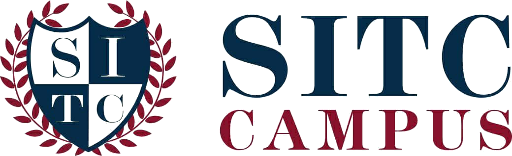

# SITC Campus

**A trilingual higher-education marketing site for Science and Information Technology City Campus, Sri Lanka.**

Rebuilt from the legacy WordPress site at [sitc.lk](https://sitc.lk/) as a fast, statically-rendered
[Next.js](https://nextjs.org) App Router website — with a programme explorer, programme detail pages,
a news archive, a WhatsApp enquiry handoff, and first-class SEO in English, Sinhala and Tamil.

[Live site](https://sitc.lk/) · [Report an issue](../../issues) · [Contributing guide](#contributing)

[](https://nextjs.org)
[](https://react.dev)
[](https://www.typescriptlang.org)
[](https://tailwindcss.com)
[](https://bun.sh)
[](#-seo-analytics--performance)

</div>

---

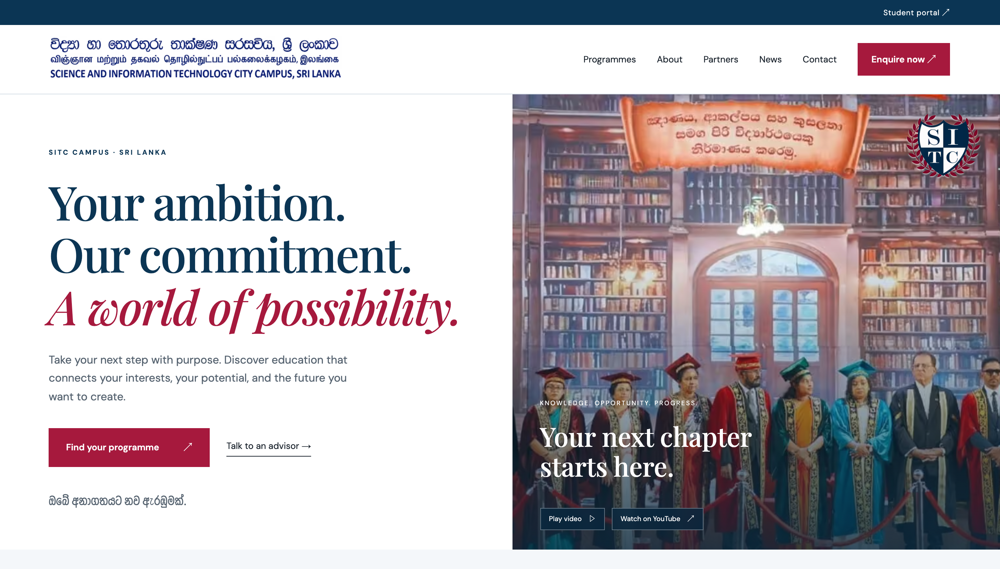

<p align="center">
  <em>The homepage hero at 1440px — deferred YouTube convocation trailer, local fonts in three scripts, server-rendered copy.</em>
</p>

## ✨ Features

- **🎯 Programme explorer** — filter by Diploma/Degree, live search with an empty state, and cards that link to full programme pages. Selecting a pathway pre-fills the enquiry form.
- **📖 Programme detail pages** — overview, study areas, outcomes, verified curricula with module credits, fees, intake dates and downloadable PDF guides for all 10 programmes.
- **📰 News archive** — original SITC articles preserved as text (Sinhala and English), with article pages, an archive listing and an RSS feed.
- **💬 WhatsApp enquiry handoff** — the contact form composes a prefilled WhatsApp message. No backend, no database, nothing stored.
- **👨‍🎓 Trilingual Vice Chancellor profile** — complete English, Sinhala and Tamil biography and welcome message with an accessible language switcher.
- **🌍 SEO & migration safe** — canonical URLs, Open Graph, JSON-LD structured data, sitemap, RSS, and 301 redirects from the legacy WordPress URL space. Retired pages return real 410s.
- **⚡ Statically rendered** — nearly everything is a Server Component; only navigation, filtering, the language switcher, the hero video and the form are client-side.
- **📐 Reference-accurate design** — layout verified element-by-element against the supplied design reference at desktop, tablet and mobile breakpoints.

### Homepage sections

| | |
|---|---|
| [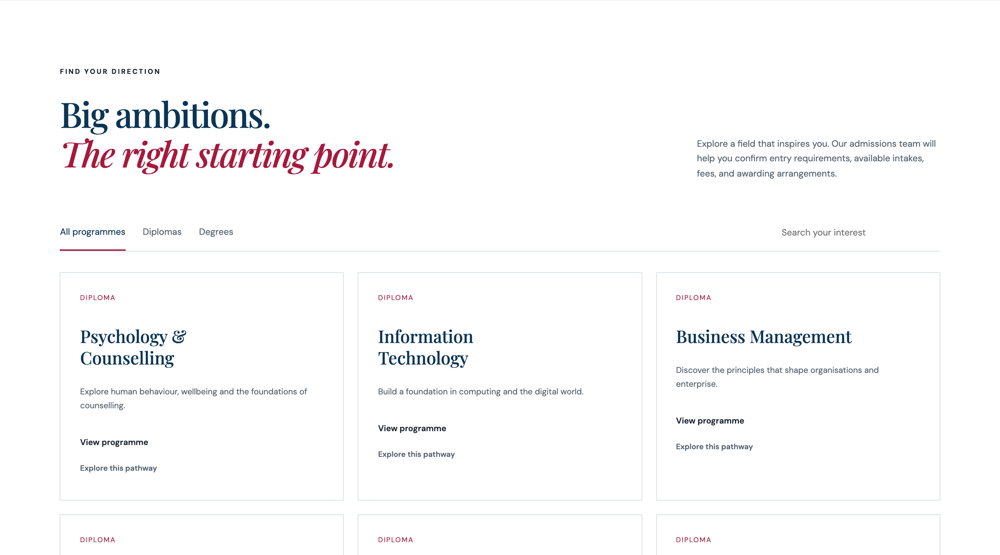](docs/screenshots/programmes.png) | [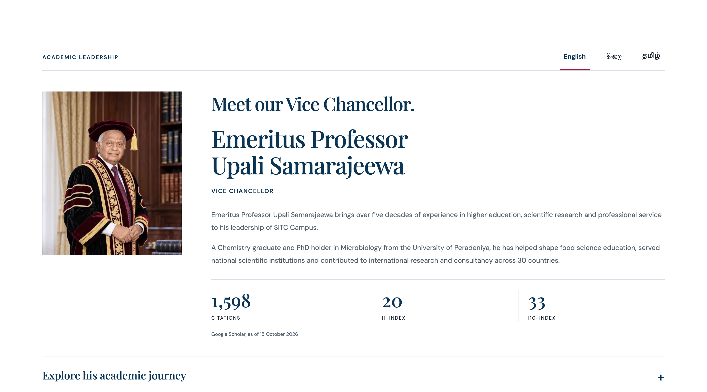](docs/screenshots/leadership.png) |
| **Programme explorer** — filters, search and pathway cards | **Academic leadership** — trilingual profile & research figures |
| [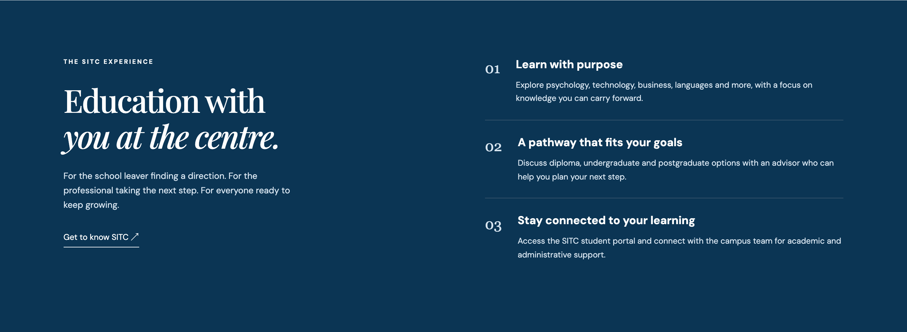](docs/screenshots/experience.png) | [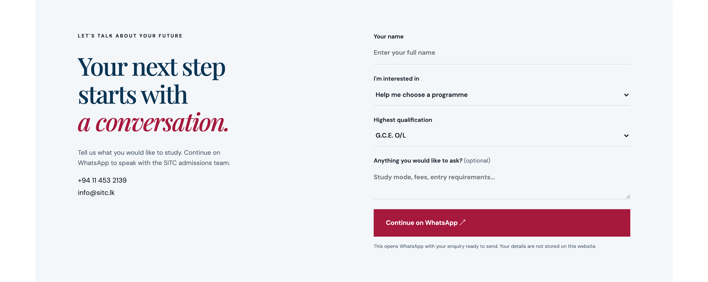](docs/screenshots/enquiry.png) |
| **Campus experience** — burgundy statement band | **Enquiry** — form that opens a prefilled WhatsApp chat |

<details>
<summary><strong>Footer — four locations, support channels & legal links</strong></summary>

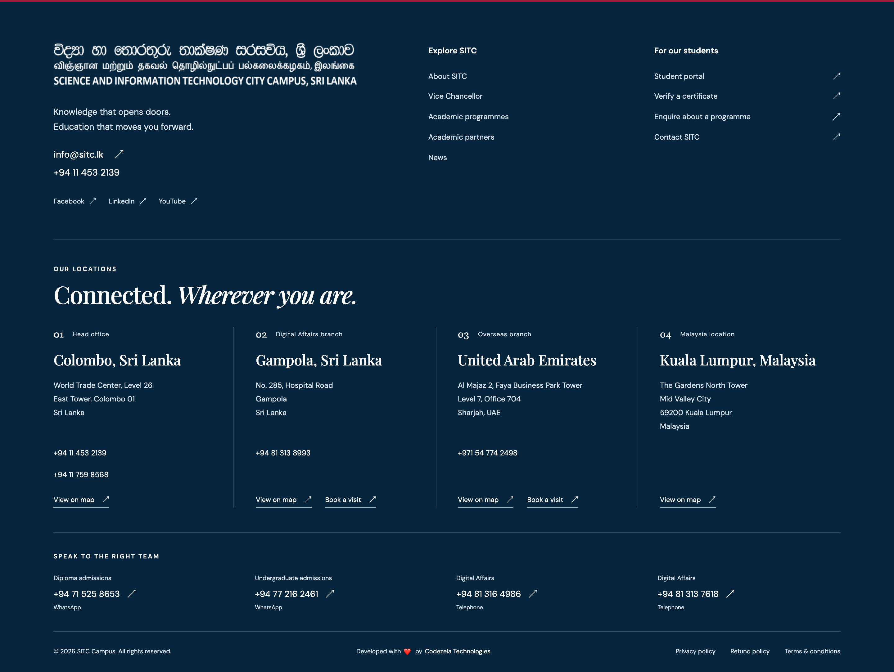

</details>

### Inner pages

| Page | Screenshot |
|---|---|
| **Programme catalogue** — `/academic-programmes/` | [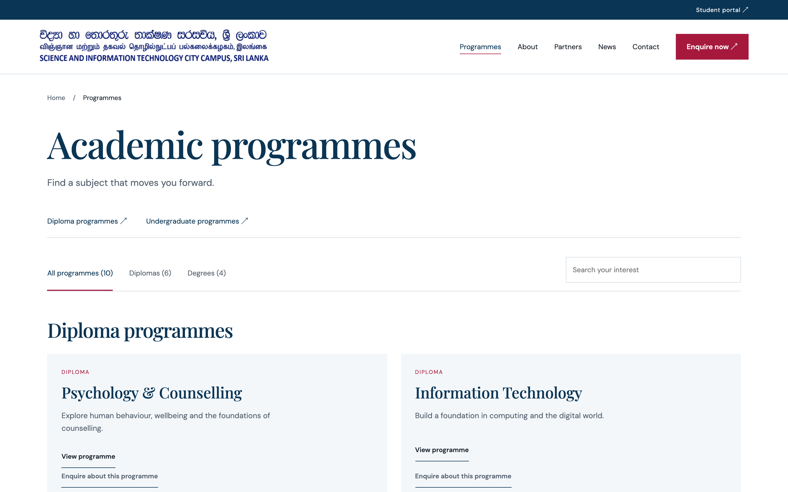](docs/screenshots/programmes-page.png) |
| **Programme detail** — `/program/<slug>/` | [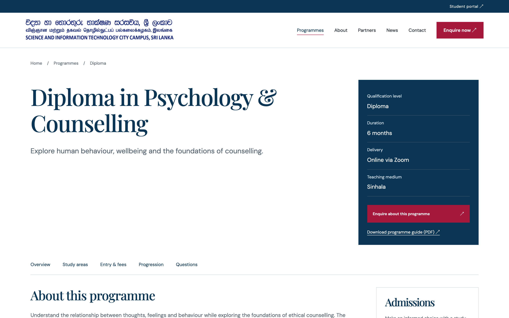](docs/screenshots/programme-detail.png) |
| **News archive** — `/news/` | [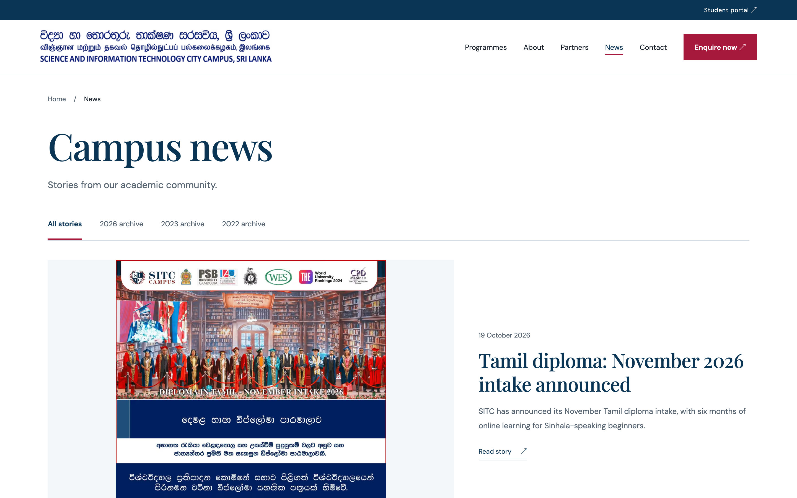](docs/screenshots/news.png) |
| **About** — `/about-us/` | [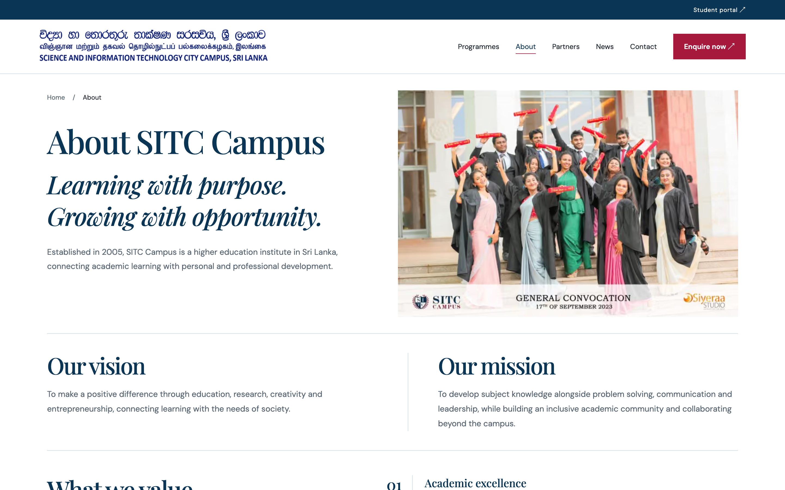](docs/screenshots/about.png) |
| **Partner institutes** — `/academic-direction-partner-institutes/` | [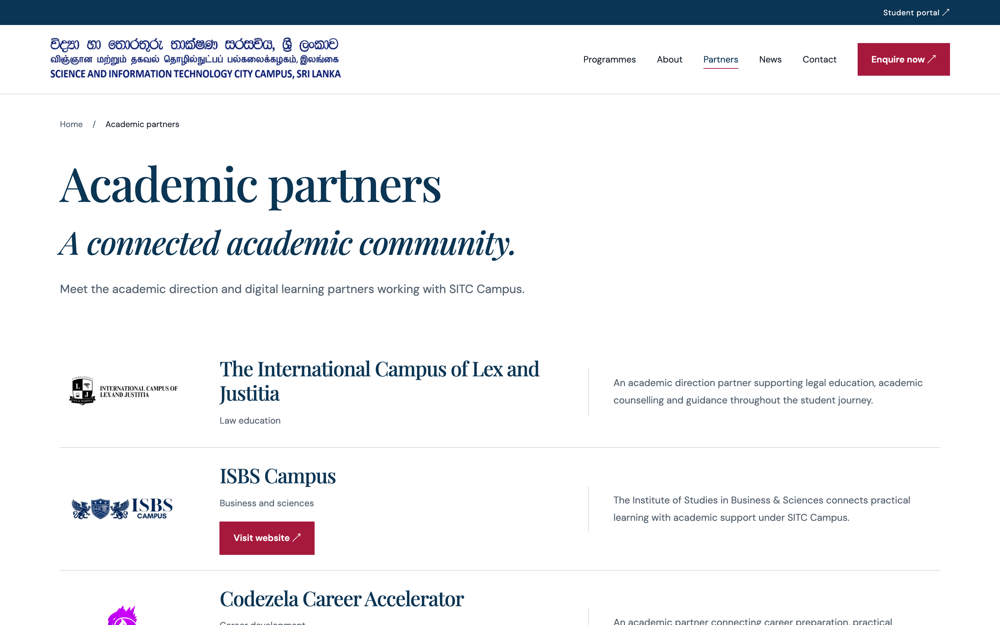](docs/screenshots/partners.png) |
| **Contact** — `/contact-us/` | [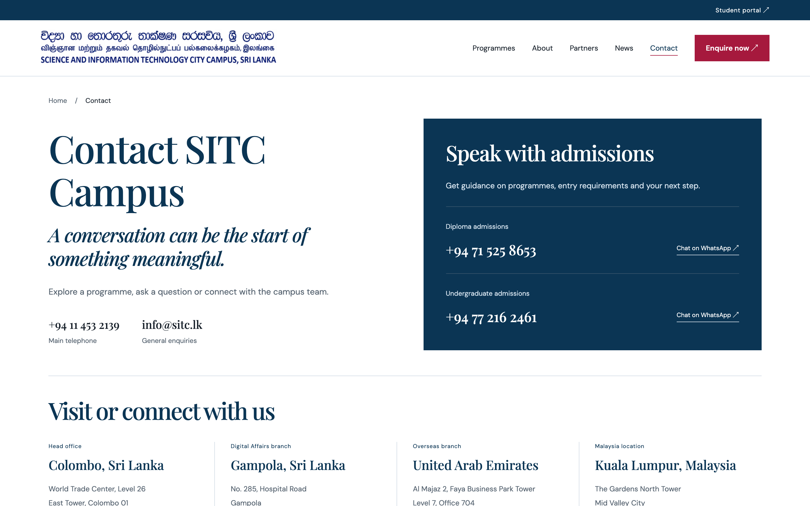](docs/screenshots/contact.png) |

### Mobile

<p>
  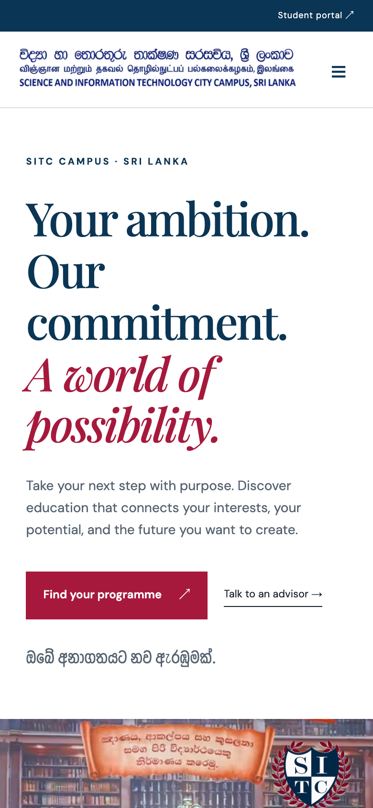
  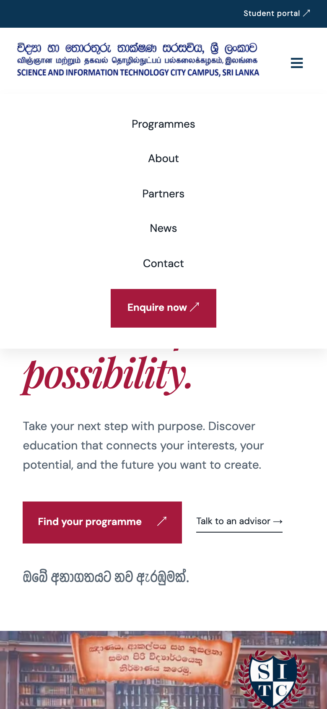
</p>

Responsive from 320px up. Navigation collapses to an accessible `aria-expanded` toggle below 640px, and every section reflows to a single column.

## 📄 Site map

| Route | Description |
|---|---|
| `/` | Homepage — hero video, highlights, programme explorer, experience, news, leadership, pathway, resources, FAQs, enquiry |
| `/academic-programmes/` | Programme catalogue with filters and search |
| `/program/<slug>/` | Programme detail pages (10 programmes) |
| `/program-level/diploma/` · `/program-level/undergraduate/` | Programme level landing pages |
| `/about-us/` | Vision, mission and values |
| `/academic-direction-partner-institutes/` | Six academic direction partners |
| `/news/` · `/news/<article>/` | News archive and original article pages |
| `/contact-us/` | Locations, support channels and the enquiry form |
| `/privacy-policy/` · `/refund-policy/` · `/terms-and-conditions/` | Legal pages |
| `/sitemap.xml` · `/robots.txt` · `/feed/` | SEO endpoints |
| `/academic-staff/` · `/events/` · `/category/uncategorized/` | Retired WordPress pages returning **410 Gone** |

Legacy WordPress URLs — including every `wp-content` asset, old sitemaps and `/program/` paths — redirect permanently to their new homes. See [Migration](#-wordpress-migration--provenance).

## 🧱 Tech stack

| Layer | Choice |
|---|---|
| Framework | [Next.js 16](https://nextjs.org) (App Router, static rendering, `trailingSlash`) |
| UI | [React 19](https://react.dev), Server Components by default, small client islands |
| Styling | [Tailwind CSS 4](https://tailwindcss.com) theme tokens + hand-written CSS ([globals.css](src/app/globals.css)) matching the reference design |
| Typography | DM Sans, Playfair Display, Yaldevi (Sinhala) and Noto Sans Tamil (Tamil) — self-hosted via `next/font/local` |
| Language | [TypeScript](https://www.typescriptlang.org) `strict` mode |
| Tests | [Bun test](https://bun.sh/docs/cli/test) |
| Tooling | ESLint (next/core-web-vitals), Prettier, [Bun](https://bun.sh) as package manager |

## 🚀 Getting started

**Prerequisites:** [Node.js 20.9+](https://nodejs.org) and [Bun 1.3+](https://bun.sh).

```sh
git clone https://github.com/sayuru-akash/sitc-campus.git
cd sitc-campus
bun install
bun run dev
```

Open <http://localhost:3000>. No environment variables are required for local development.

> **Note** — canonical and social URLs are intentionally pinned to `https://sitc.lk/` even in local previews, so localhost can never leak into search metadata. Change [src/content/seo.ts](src/content/seo.ts) only if the real domain changes.

### Production build

```sh
bun run build
bun run start        # serves on port 3000
```

## 🔧 Scripts

| Command | Purpose |
|---|---|
| `bun run dev` | Start the dev server on <http://localhost:3000> |
| `bun run build` | Production build |
| `bun run start` | Serve the production build |
| `bun run lint` | ESLint with **zero warnings allowed** |
| `bun run typecheck` | `tsc --noEmit` |
| `bun test` | Unit tests (analytics, enquiry, migration contracts, retired pages) |
| `bun run format` / `format:check` | Prettier write / check |
| `node scripts/verify-layout.mjs` | Compare rendered DOM geometry against recorded reference measurements |
| `python3 scripts/verify-public-migration.py` | Full HTTP audit of the built site (see below) |

### Full site verification

With the built site running on port 3100:

```sh
PORT=3100 bun run start &
python3 scripts/verify-public-migration.py
```

The script checks page statuses, metadata, canonical URLs, sitemap and RSS, legacy media, redirects, internal links and JSON-LD — read-only, no form submissions.

## 🌍 Environment variables

No variables are required. One optional flag exists:

| Variable | Default | Purpose |
|---|---|---|
| `PREVENT_INDEXING` | `false` | Set `true` for public staging builds → `noindex, nofollow` everywhere. Vercel preview deployments get this automatically; production must leave it unset or `false`. |

## 📁 Project structure

```
sitc-campus/
├── src/
│   ├── app/
│   │   ├── page.tsx              # Homepage — section assembly
│   │   ├── layout.tsx            # Root layout, local fonts, GA
│   │   ├── globals.css           # Design system, reference measurements
│   │   ├── (campus)/             # All inner pages share header/footer
│   │   │   ├── about-us/         #   About
│   │   │   ├── academic-programmes/
│   │   │   ├── program/[slug]/   #   Programme detail
│   │   │   ├── program-level/[level]/
│   │   │   ├── news/             #   Archive + [slug] article pages
│   │   │   ├── contact-us/
│   │   │   ├── privacy-policy/ · refund-policy/ · terms-and-conditions/
│   │   │   └── academic-direction-partner-institutes/
│   │   ├── academic-staff/ · events/ · category/uncategorized/   # 410 routes
│   │   ├── sitemap.ts · robots.ts · feed/
│   │   └── not-found.tsx
│   ├── components/
│   │   ├── sections/             # Homepage sections (hero, explorer, leadership…)
│   │   ├── ui/                   # ButtonLink, Eyebrow
│   │   └── …                     # Header, footer, hero video, analytics, cards
│   ├── content/                  # ✏️ ALL site content lives here (see below)
│   ├── lib/                      # SEO helpers, enquiry URL, analytics, news utils
│   └── types/content.ts
├── public/
│   ├── images/ · fonts/ · guides/   # Local assets (incl. programme PDF guides)
│   └── wp-content/…                 # Legacy WordPress media at original paths
├── docs/
│   ├── screenshots/              # Screenshots used in this README
│   ├── design-references/        # Original design + local comparison captures
│   └── research/                 # Migration maps, measurements, specs, audits
├── scripts/                      # Layout & public-migration verifiers
└── tests/                        # Bun unit tests
```

## ✏️ Editing content

All copy is typed content in [src/content/](src/content) — no CMS, no database.

| To change… | Edit |
|---|---|
| Programme titles, descriptions, levels | [programmes.ts](src/content/programmes.ts) — one record updates the explorer, the catalogue, the enquiry dropdown **and** the sitemap |
| Programme slugs / routes | [programme-routes.ts](src/content/programme-routes.ts) — ⚠️ changing a slug breaks a published URL; add a redirect in [next.config.ts](next.config.ts) |
| Full programme details, curricula, fees, guides | [programme-details.ts](src/content/programme-details.ts) |
| News cards & archive | [news.ts](src/content/news.ts) — every story needs a matching article |
| Full article text | [news-articles.ts](src/content/news-articles.ts) |
| Navigation, locations, phones, social links | [site.ts](src/content/site.ts) |
| FAQs | [faqs.ts](src/content/faqs.ts) |
| Campus video (YouTube ID, times, metadata) | [campus-video.ts](src/content/campus-video.ts) |
| Page titles & meta descriptions | [page-metadata.ts](src/content/page-metadata.ts) and [seo.ts](src/content/seo.ts) |
| Vice Chancellor profile (EN/SI/TA) | [leadership.ts](src/content/leadership.ts) |
| About page (vision, mission, values) | [about.ts](src/content/about.ts) |
| Partner institutes | [partners.ts](src/content/partners.ts) |
| Legal pages | [policies.ts](src/content/policies.ts) |
| Homepage section order | [src/app/page.tsx](src/app/page.tsx) |
| Design tokens, measurements, breakpoints | [src/app/globals.css](src/app/globals.css) (breakpoints: 900px and 640px) |

`ProgrammeSelectionProvider` (a client context) is the only bridge between server sections — it carries the selected programme from cards to the enquiry form.

## 🔍 SEO, analytics & performance

- **Metadata** — every route sets its own canonical URL, description, Open Graph and Twitter cards; future routes and 404s never inherit homepage metadata.
- **Structured data** — `EducationalOrganization`, address, contact and video JSON-LD on the homepage; `Article` and breadcrumb schema on content pages.
- **Analytics** — GA4 loads **only** in production builds on `sitc.lk` / `www.sitc.lk` (never localhost, previews or lookalike hosts) and tracks contact/enquiry events. Config: [src/lib/analytics.ts](src/lib/analytics.ts).
- **Indexing control** — `PREVENT_INDEXING=true` or Vercel preview → `noindex, nofollow` plus an empty sitemap.

Lighthouse 13, mobile preset, production build ([full report](docs/research/lighthouse-summary-2026-10-22.json)):

| Page | Performance | Accessibility | Best practices | SEO |
|---|---|---|---|---|
| `/` | 91 | 100 | 100 | 100 |
| `/about-us/` | 96 | 100 | 100 | 100 |
| `/academic-programmes/` | 96 | 100 | 100 | 100 |
| `/contact-us/` | 96 | 100 | 100 | 100 |
| `/program/diploma-in-business-management/` | 97 | 100 | 100 | 100 |
| `/news/` | 89 | 100 | 100 | 100 |

Zero cumulative layout shift on every measured page.

## ✅ Testing

```sh
bun test            # analytics gating, WhatsApp URL encoding, migration contracts, 410 pages
bun run lint        # eslint --max-warnings=0
bun run typecheck
```

The tests protect **behaviour contracts** rather than markup: published URLs, fee figures, Unicode-safe enquiry encoding, analytics host gating, and real 410 responses for retired pages. Layout fidelity is checked separately against recorded reference geometry via `node scripts/verify-layout.mjs`.

## 🔄 WordPress migration & provenance

This project replaces the WordPress site at <https://sitc.lk/>.

- Original content, contact details, locations and media were extracted with permission and preserved in `docs/research/` — see [SOURCES.md](docs/research/SOURCES.md), [PAGE_TOPOLOGY.md](docs/research/PAGE_TOPOLOGY.md) and [BEHAVIORS.md](docs/research/BEHAVIORS.md).
- Every published URL keeps working: `wp-content` assets are served from their original paths, old sitemaps redirect to `/sitemap.xml`, and programme slugs that changed have permanent redirects.
- Removed sections (academic staff, events, uncategorized archive) return **410 Gone** with `noindex, follow` — deliberately not redirected.
- Financial figures and curricula are treated as migration contracts and covered by tests.

<details>
<summary><strong>📁 Full research index</strong></summary>

| Document | Contents |
|---|---|
| [SOURCES.md](docs/research/SOURCES.md) | Provenance of every asset and fact |
| [PAGE_TOPOLOGY.md](docs/research/PAGE_TOPOLOGY.md) | Homepage section order & rendering strategy |
| [BEHAVIORS.md](docs/research/BEHAVIORS.md) | Observed reference interactions & breakpoints |
| [MAIN-PAGES-IMPLEMENTATION.md](docs/research/MAIN-PAGES-IMPLEMENTATION.md) · [DETAIL-PAGES-MIGRATION.md](docs/research/DETAIL-PAGES-MIGRATION.md) | Implementation notes |
| [QA.md](docs/research/QA.md) | Manual QA protocol (incl. enquiry URL inspection without sending) |
| [SEO-AUDIT-2026-10-21.md](docs/research/SEO-AUDIT-2026-10-21.md) · [SEO-PERFORMANCE-2026-10-22.md](docs/research/SEO-PERFORMANCE-2026-10-22.md) · [ANALYTICS-2026-10-23.md](docs/research/ANALYTICS-2026-10-23.md) | Audits |
| [LEADERSHIP-UPDATE.md](docs/research/LEADERSHIP-UPDATE.md) · [CONTACT-VIDEO-UPDATE.md](docs/research/CONTACT-VIDEO-UPDATE.md) | Content refresh provenance |
| [sitc-migration-map.csv](docs/research/sitc-migration-map.csv) · [sitc-url-inventory-2026-10-21.csv](docs/research/sitc-url-inventory-2026-10-21.csv) | URL-by-URL migration mapping |
| [components/*.spec.md](docs/research/components/) | Section-level specifications |
| [reference.css](docs/research/reference.css) · measurements JSONs | Exact reference geometry |

</details>

## Contributing

1. `bun install && bun run dev`
2. Make your change — content lives in `src/content/`, styles in `globals.css`.
3. Run `bun run lint && bun run typecheck && bun test` and fix everything.
4. For layout or visual changes, recapture `docs/design-references/` comparisons and run `node scripts/verify-layout.mjs`.
5. For URL changes, keep legacy URLs redirecting and update the migration tests.

---

<div align="center">

**SITC Campus** · Science and Information Technology City Campus, Sri Lanka

Website developed with ❤️ by [Codezela Technologies](https://codezela.com)

</div>
